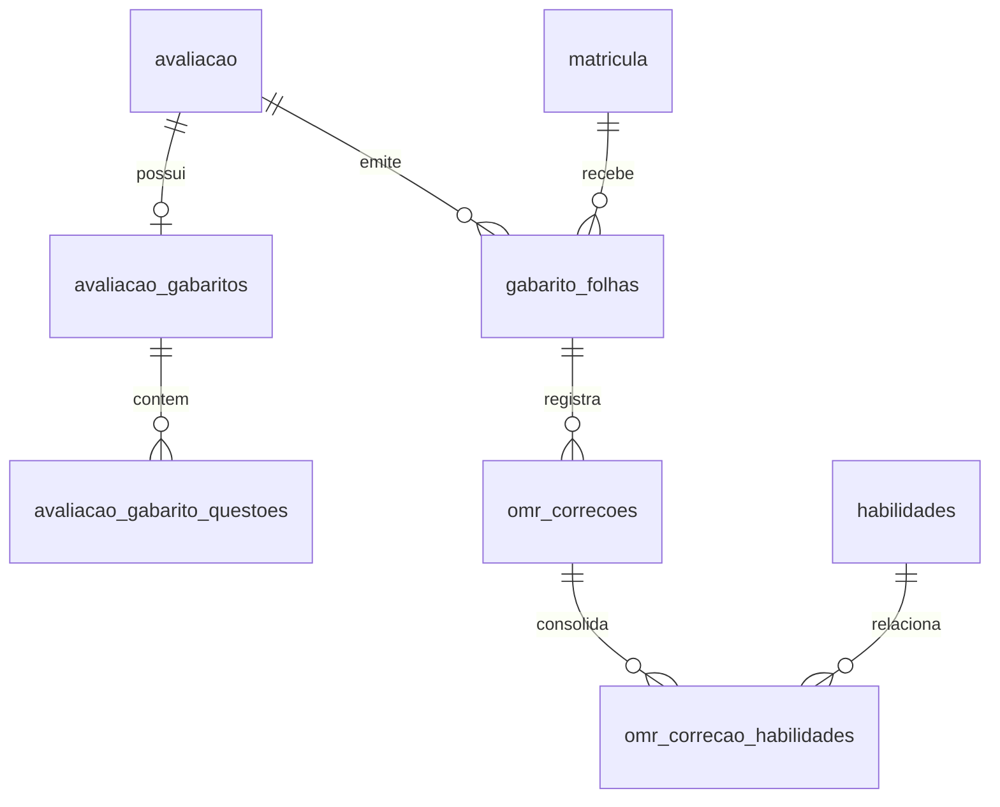

# Correção Automática de Gabaritos por Foto (OMR)

Esta documentação descreve a arquitetura, o modelo de dados, o pipeline de visão computacional em GD puro (PHP 8.2), as permissões de segurança, os limiares configuráveis e as rotinas operacionais da funcionalidade de correção de gabaritos no Torre360.

---

## 1. Visão Geral e Arquitetura

O sistema de OMR (*Optical Mark Recognition*) do Torre360 foi projetado para operar com **custo zero de inferência externa**, **total privacidade de dados de menores** e **alta tolerância a distorções geométricas** (fotos tiradas com celular em ângulo, iluminação variável e rotações).

### Princípios Fundamentais:
1. **Motor Primário Determinístico (GD Puro):** Não requer extensões externas não padronizadas (como Imagick ou OpenCV). Todo o processamento de imagem roda em PHP com a extensão nativa `gd` (disponível por padrão no PHP 8.2 / XAMPP e na maioria dos ambientes Linux).
2. **Layout Canônico Único (`GabaritoLayout`):** Geometria parametrizada em milímetros (A4 retrato: 210 × 297 mm). O mesmo objeto que dita o desenho vetorial (SVG) no gerador de folhas em PDF dita as coordenadas esperadas pelo motor OMR.
3. **Anonimização e Identificação Opaca por UUID:** A folha de respostas gerada contém um QR Code contendo **apenas um UUID v4** vinculado à tabela `gabarito_folhas`. Nenhum dado pessoal (nome, matrícula, CPF ou ID sequencial) trafega no QR Code.
4. **Fallback Gemini Vision Desligado por Padrão:** O envio para modelo multimodal (Gemini 2.5 Flash) existe apenas como fallback opcional e desligado (`OMR_FALLBACK_GEMINI=false`). Quando habilitado, apenas o recorte estrito da grade de respostas é enviado (sem cabeçalho, sem nome e sem QR Code).
5. **Lançamento Transacional e Idempotente:** Nenhuma nota é gravada sem confirmação humana na interface do Filament. O lançamento final utiliza o serviço oficial `NotaLancamentoService::salvarNotas()` dentro de transação com trava atômica.

---

## 2. Modelo de Dados e Tabelas



### Tabelas Criadas:
- `avaliacao_gabaritos`: Configuração mestre do gabarito da avaliação (`total_questoes`, `alternativas`, `layout_versao`, `layout`, `anulacao_modo`).
- `avaliacao_gabarito_questoes`: Gabarito item a item (`numero`, `alternativa_correta`, `peso`, `habilidade_id`, `anulada`).
- `gabarito_folhas`: Folhas individuais de resposta (`uuid`, `avaliacao_id`, `matricula_id`, `layout_versao`, `gerada_por`, `corrigida_em`).
- `omr_correcoes`: Registro do processamento da foto, conferência e lançamento (`status`, `respostas`, `respostas_finais`, `alertas`, `acertos`, `total_validas`, `nota_calculada`, `motor`, `tempo_ms`).
- `omr_correcao_habilidades`: Consolidação do aproveitamento pedagógico por habilidade BNCC vinculado às questões acertadas.

---

## 3. Pipeline do Motor OMR (`OmrService`)

O pipeline de leitura executa 10 etapas determinísticas em memória:

```
[ Upload da Imagem ]
       │
       ▼
 1. Validação de MIME (finfo), Magic Bytes e Image Bomb
       │
       ▼
 2. Correção de Orientação EXIF (exif_read_data)
       │
       ▼
 3. Redimensionamento Precoce (~1600 px no maior lado)
       │
       ▼
 4. Binarização Adaptativa com Imagem Integral (Tons de Cinza -> Preto/Branco)
       │
       ▼
 5. Detecção de Marcadores de Canto em Janelas Restritas (13% L × 10% A)
       │
       ▼
 6. Identificação de Rotação e Orientação (Marcador TL Assimétrico)
       │
       ▼
 7. Projeção Homográfica Bilinear para Canvas Canônico (GabaritoLayout)
       │
       ▼
 8. Leitura do QR Code Opaco no Recorte Calibrado
       │
       ▼
 9. Leitura de Densidade Óptica das Bolhas (Máscara Circular com Normalização de Fundo)
       │
       ▼
10. Classificação das Respostas (valida, em_branco, dupla, ambigua, ilegivel)
```

### Calibração e Detecção dos Marcadores de Canto:
- As folhas possuem 4 marcadores nos cantos com geometria assimétrica:
  - **Superior Esquerdo (TL):** Quadrado preenchido 14 × 14 mm.
  - **Superior Direito (TR):** Retângulo 14 × 7 mm.
  - **Inferior Esquerdo (BL):** Quadrado vazado (anel) 14 × 14 mm.
  - **Inferior Direito (BR):** Círculo preenchido raio 7 mm.
- **Janela de Busca Estrita:** A busca pelos centróides é delimitada nos primeiros 13% da largura e 10% da altura dos cantos, impedindo falso-positivos originados por QR Codes ou assinaturas.

---

## 4. Limiares e Configuração (`config/omr.php`)

Todos os parâmetros são parametrizáveis e podem ser sobrescritos por variáveis de ambiente:

| Parâmetro | Padrão | Descrição |
|---|---|---|
| `OMR_LIMIAR_MARCADA` | `0.42` | Fração mínima de preenchimento escuro para considerar a bolha como marcada. |
| `OMR_LIMIAR_VAZIA` | `0.18` | Fração máxima para considerar a bolha como desmarcada/em branco. |
| `OMR_DELTA_DUPLA` | `0.12` | Se duas bolhas na mesma linha superarem `limiar_marcada` com diferença inferior a este delta, a questão é classificada como marcação dupla. |
| `OMR_RESOLUCAO_CANONICA` | `1600` | Largura em pixels do canvas retificado pela homografia. |
| `OMR_MAX_ARQUIVOS` | `50` | Limite de fotos enviadas em lote na interface do Filament. |
| `OMR_RETENCAO_DIAS` | `30` | Período de guarda da foto original antes da purga automática. |
| `OMR_FALLBACK_GEMINI` | `false` | Se `true`, ativa envio opcional do recorte para Gemini Vision caso os marcadores falhem. |

---

## 5. Permissões e Segurança (Filament Shield)

As permissões seguem o padrão canônico `PascalCase` com dois-pontos:

- `GerenciarGabarito:Avaliacao`:
  - Permite configurar o gabarito (respostas, pesos, habilidades) na edição da Avaliação.
  - Permite gerar e baixar as folhas de respostas em PDF (individual ou turma).
  - **Papéis Padrão:** `super_admin`, `admin`, `coordenador`, `professor`.
- `CorrigirGabarito:Avaliacao`:
  - Permite acessar a interface de correção por foto / câmera (`CorrigirGabarito`).
  - Permite conferir, editar respostas e lançar notas oficiais em lote.
  - **Papéis Padrão:** `super_admin`, `admin`, `coordenador`, `professor`.

### Proteções de Acesso (Escopo Pedagógico):
- O professor só pode acessar avaliações das turmas em que leciona a respectiva disciplina (validado no `AvaliacaoPolicy::corrigirGabarito()`).
- O download dos PDFs e a rota de imagens retificadas são protegidos por `Gate::authorize()` e tokens temporários assinados.

---

## 6. Operação da Fila de Processamento

Para garantir tempo de resposta na interface e evitar estouro de memória, o processamento de imagens e geração de folhas em lote roda em fila assíncrona:

### Filas Utilizadas:
- `OMR_FILA` (padrão: `omr` ou `default`):
  - Job: `App\Jobs\ProcessarGabaritoOmrJob` (processa uma foto individualmente).
  - Job: `App\Jobs\GerarFolhasTurmaPdfJob` (monta o PDF de toda a turma em background).

### Como iniciar o Worker de Fila em Produção:
```bash
php artisan queue:work --queue=omr,default --tries=3 --timeout=120 --memory=512
```

---

## 7. Retenção e Purga de Arquivos (LGPD)

As imagens enviadas contêm grafia de alunos e são consideradas dados sensíveis temporários. Após a confirmação do lançamento das notas, o armazenamento permanente da imagem não é necessário.

### Comando Agendado:
O comando `omr:purga-arquivos` é executado diariamente via scheduler (`routes/console.php`):
```bash
php artisan omr:purga-arquivos
```
- Remove fotos de correções concluídas há mais de `OMR_RETENCAO_DIAS` dias (padrão: 30 dias).
- Remove imagens de rascunhos descartados ou com erro após 48 horas.
- Preserva integralmente o histórico de respostas (`respostas_finais`), notas e auditoria na tabela `omr_correcoes`.
