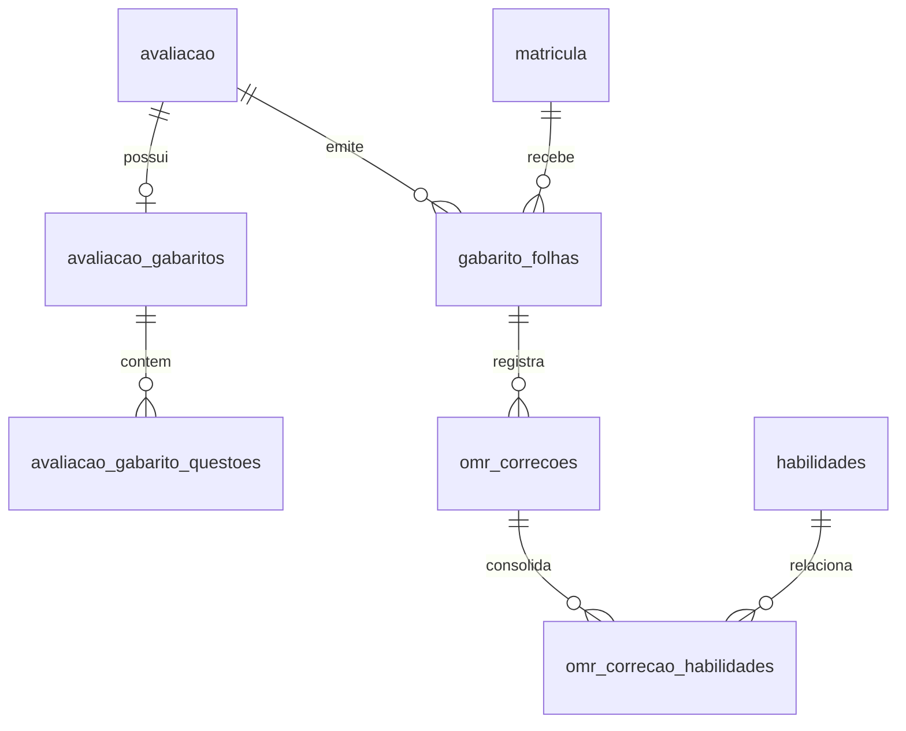

# Correção Automática de Gabaritos por Foto (OMR)

Esta documentação descreve a arquitetura, o modelo de dados, o pipeline de visão computacional em GD puro (PHP 8.2), as permissões de segurança, os limiares configuráveis e as rotinas operacionais da funcionalidade de correção de gabaritos no Torre360.

---

## 1. Visão Geral e Arquitetura

O sistema de OMR (*Optical Mark Recognition*) do Torre360 foi projetado para operar com **custo zero de inferência externa**, **total privacidade de dados de menores** e **alta tolerância a distorções geométricas** (fotos tiradas com celular em ângulo, iluminação variável e rotações).

### Princípios Fundamentais:
1. **Motor Primário Determinístico (GD Puro):** Não requer extensões externas não padronizadas (como Imagick ou OpenCV). Todo o processamento de imagem roda em PHP com a extensão nativa `gd` (disponível por padrão no PHP 8.2 / XAMPP e na maioria dos ambientes Linux).
2. **Layout Canônico Único (`GabaritoLayout`):** Geometria parametrizada em milímetros (A4 retrato: 210 × 297 mm). O mesmo objeto que dita o desenho vetorial (SVG) no gerador de folhas em PDF dita as coordenadas esperadas pelo motor OMR.
3. **Anonimização e Identificação Opaca por UUID:** A folha de respostas gerada contém um QR Code contendo **apenas um UUID v4** vinculado à tabela `gabarito_folhas`. Nenhum dado pessoal (nome, matrícula, CPF ou ID sequencial) trafega no QR Code.
4. **Motor 100% Determinístico em GD Puro (Sem LLM de Visão):** O reconhecimento óptico roda integralmente no servidor através de binarização adaptativa e homografia bilinear em PHP nativo. Não envia fotos ou recortes para APIs de IA externas (zero custo de inferência e total aderência à LGPD). O fallback multimodal planejado não foi implementado nesta versão para preservar o isolamento completo de dados e reprodutibilidade determinística.
5. **Lançamento Transacional e Idempotente:** Nenhuma nota é gravada sem confirmação humana na interface do Filament. O lançamento final utiliza o serviço oficial `NotaLancamentoService::salvarNotas()` dentro de transação com trava atômica.

---

## 2. Modelo de Dados e Tabelas



### Tabelas Criadas:
- `avaliacao_gabaritos`: Configuração mestre do gabarito da avaliação (`total_questoes`, `alternativas`, `layout_versao`, `layout`, `anulacao_modo`).
- `avaliacao_gabarito_questoes`: Gabarito item a item (`numero`, `alternativa_correta`, `peso`, `habilidade_id`, `anulada`).
- `gabarito_folhas`: Folhas individuais de resposta (`uuid`, `avaliacao_id`, `matricula_id`, `layout_versao`, `gerada_por`, `corrigida_em`).
- `omr_correcoes`: Registro do processamento da foto, conferência e lançamento (`status`, `respostas`, `respostas_finais`, `alertas`, `acertos`, `total_validas`, `nota_calculada`, `motor`, `tempo_ms`).
- `omr_correcao_habilidades`: Consolidação do aproveitamento pedagógico por habilidade BNCC vinculado às questões acertadas.

---

## 3. Pipeline do Motor OMR (`OmrService`)

O pipeline de leitura executa 10 etapas determinísticas em memória:

```
[ Upload da Imagem ]
       │
       ▼
 1. Validação de MIME (finfo), Magic Bytes e Image Bomb
       │
       ▼
 2. Correção de Orientação EXIF (exif_read_data)
       │
       ▼
 3. Redimensionamento Precoce (~1600 px no maior lado)
       │
       ▼
 4. Binarização Adaptativa com Imagem Integral (Tons de Cinza -> Preto/Branco)
       │
       ▼
 5. Detecção de Marcadores de Canto em Janelas Restritas (13% L × 10% A)
       │
       ▼
 6. Identificação de Rotação e Orientação (Marcador TL Assimétrico)
       │
       ▼
 7. Projeção Homográfica Bilinear para Canvas Canônico (GabaritoLayout)
       │
       ▼
 8. Leitura do QR Code Opaco no Recorte Calibrado
       │
       ▼
 9. Leitura de Densidade Óptica das Bolhas (Máscara Circular com Normalização de Fundo)
       │
       ▼
10. Classificação das Respostas (valida, em_branco, dupla, ambigua, ilegivel)
```

### Calibração e Detecção dos Marcadores de Canto:
- As folhas possuem 4 marcadores nos cantos com geometria assimétrica:
  - **Superior Esquerdo (TL):** Quadrado preenchido 14 × 14 mm.
  - **Superior Direito (TR):** Retângulo 14 × 7 mm.
  - **Inferior Esquerdo (BL):** Quadrado vazado (anel) 14 × 14 mm.
  - **Inferior Direito (BR):** Círculo preenchido raio 7 mm.
- **Janela de Busca Estrita:** A busca pelos centróides é delimitada nos primeiros 13% da largura e 10% da altura dos cantos, impedindo falso-positivos originados por QR Codes ou assinaturas.

---

## 4. Limiares e Configuração (`config/omr.php`)

Todos os parâmetros são parametrizáveis e podem ser sobrescritos por variáveis de ambiente:

| Parâmetro | Padrão | Descrição |
|---|---|---|
| `OMR_LIMIAR_MARCADA` | `0.42` | Fração mínima de preenchimento escuro para considerar a bolha como marcada. |
| `OMR_LIMIAR_VAZIA` | `0.18` | Fração máxima para considerar a bolha como desmarcada/em branco. |
| `OMR_MAX_ARQUIVOS` | `45` | Limite de fotos enviadas em lote na interface do Filament. |
| `OMR_RETENCAO_DIAS` | `30` | Período de guarda da foto (cópia reencodada) antes da purga automática. |
| `OMR_FILA` | `default` | Fila dos jobs de OMR. |

Uma bolha entre `OMR_LIMIAR_VAZIA` e `OMR_LIMIAR_MARCADA` é lida como **ambígua**. A leitura amostra 80% do raio da bolha, então só um preenchimento relevante passa o limiar de marcada. Duas ou mais bolhas marcadas na mesma questão são lidas como **dupla marcação** (a questão não pontua e fica sinalizada).

> A resolução do canvas retificado e o tamanho da janela de busca dos marcadores são constantes do código (`GabaritoLayout`, `MarcadorDetector`), não variáveis de ambiente.

---

## 5. Permissões e Segurança (Filament Shield)

As permissões seguem o padrão canônico `PascalCase` com dois-pontos:

- `GerenciarGabarito:Avaliacao`:
  - Permite configurar o gabarito (respostas, pesos, habilidades) na edição da Avaliação.
  - Permite gerar e baixar as folhas de respostas em PDF (individual ou turma).
  - **Papéis Padrão:** `super_admin`, `admin`, `coordenador`, `professor`.
- `CorrigirGabarito:Avaliacao`:
  - Permite acessar a interface de correção por foto / câmera (`CorrigirGabarito`).
  - Permite conferir as folhas lidas, associar o aluno quando o QR falha, descartar e lançar notas.
  - **Papéis Padrão:** `super_admin`, `admin`, `coordenador`, `professor`.

> A conferência **não edita** respostas individuais: a folha lida só pode ser lançada, descartada ou reenviada com uma foto melhor. A edição questão a questão não está implementada.

### Proteções de Acesso (Escopo Pedagógico):
- Quem tem o papel de professor só gerencia e corrige as **próprias** avaliações (`professor_id` entre as pessoas do usuário). O escopo está na `AvaliacaoPolicy` (`gerenciarGabarito()` e `corrigirGabarito()`), porque as rotas de PDF resolvem a avaliação direto pelo id, sem passar pelo `AvaliacaoResource`. Coordenação e administração veem todas.
- O download dos PDFs passa por `Gate::authorize()` no registro específico (folha ou avaliação). O download de PDFs gerados em fila só aceita caminhos no padrão `gabaritos/folhas_turma_avaliacao_{id}_{token}.pdf` e autoriza a avaliação do nome. Não existe rota de imagem retificada nem URL assinada: a foto fica em disco privado e não é exibida na interface.
- Os métodos da tela de conferência (`lancarNotaIndividual`, `associarMatricula`, `descartarCorrecao`, `lancarTodasConfirmadas`) só atuam sobre correções **da avaliação aberta**: um id de outra avaliação vindo do navegador é ignorado.

### Lançamento de notas:
- Vai sempre por `NotaLancamentoService::salvarNotas()`, em transação com trava de linha, e só para correções `aguardando_conferencia` com aluno identificado e nota calculada. Folha com falha de leitura ou descartada nunca vira nota; lançar de novo uma correção já lançada é idempotente (não regrava nem duplica a auditoria).
- **Nota já lançada e diferente nunca é sobrescrita sem confirmação:** o cartão da folha mostra "nota atual → nota da folha" e só o botão "Sobrescrever a nota atual" a substitui.
- **"Lançar Notas Prontas"** (lote) lança apenas folhas com aluno identificado, sem marcação dupla, ambígua ou ilegível e sem conflito. As demais ficam na tela, e o aviso final diz quantas e por quê.
- Folha com marcação a conferir pede confirmação (`wire:confirm`) antes do lançamento individual.
- A mesma imagem enviada duas vezes para a avaliação gera um alerta de duplicidade (SHA-256 do arquivo original).
- Uma folha cujo QR pertence a **outra avaliação** não é vinculada à correção, não identifica o aluno e não é marcada como corrigida.

---

## 6. Operação da Fila de Processamento

A geração do PDF da turma inteira roda em fila (`GerarFolhasTurmaPdfJob`). **A leitura das fotos roda de forma síncrona** na própria requisição da tela de conferência (até `OMR_MAX_ARQUIVOS` imagens por envio, reduzidas a ~1600 px): um lote grande pode demorar. O job `ProcessarGabaritoOmrJob` existe, mas **ainda não está ligado à interface**.

### Filas Utilizadas:
- `OMR_FILA` (padrão: `default`):
  - Job: `App\Jobs\GerarFolhasTurmaPdfJob` (monta o PDF de toda a turma em background).
  - Job: `App\Jobs\ProcessarGabaritoOmrJob` (processa uma foto; reservado para o processamento assíncrono).

### Como iniciar o Worker de Fila em Produção:
```bash
php artisan queue:work --queue=omr,default --tries=3 --timeout=120 --memory=512
```

---

## 7. Retenção e Purga de Arquivos (LGPD)

As imagens enviadas contêm grafia de alunos e são consideradas dados sensíveis temporários. Após a confirmação do lançamento das notas, o armazenamento permanente da imagem não é necessário.

### Comando Agendado:
O comando `omr:purgar-arquivos-antigos` é executado diariamente via scheduler (`routes/console.php`):
```bash
php artisan omr:purgar-arquivos-antigos
```
- Remove a foto de **toda** correção com mais de `OMR_RETENCAO_DIAS` dias (padrão: 30), seja qual for o status: confirmada, descartada, com falha de leitura ou abandonada na conferência.
- Remove uploads temporários (`omr/uploads`) com mais de 24 horas. O upload original é apagado logo após o processamento; o que fica é uma cópia reencodada, sem EXIF/GPS.
- Preserva o resultado (respostas, nota, alertas) e a auditoria na tabela `omr_correcoes`; o campo `arquivo_path` passa a `purgado_lgpd`.
